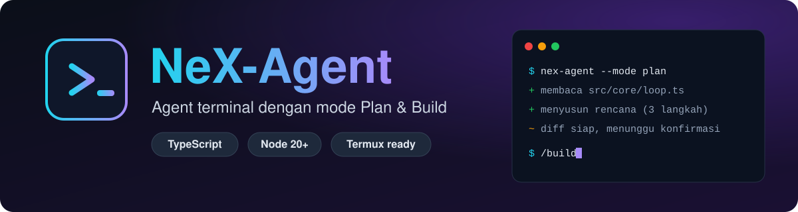

<p align="center">
  
</p>

<p align="center">
  
  
  
  
  
</p>

<p align="center">
  <b>Agent berbasis terminal</b> dengan loop agentik, dua mode (<b>Plan</b> &amp; <b>Build</b>),<br>
  soft workspace boundary, diff + konfirmasi, checkpoint/undo, dan arsitektur <b>multi-provider</b>.<br>
  Dibangun CLI-first dengan TypeScript strict.
</p>

<p align="center">
  <a href="#instalasi">🚀 Instalasi</a> ·
  <a href="#penggunaan">⌨️ Penggunaan</a> ·
  <a href="#web">🌐 Web</a> ·
  <a href="#telegram">🤖 Telegram</a> ·
  <a href="#mcp">🔌 MCP</a> ·
  <a href="#skill">🧠 Skill</a>
</p>

---

## ✨ Fitur Unggulan

| | Fitur | Keterangan |
|---|---|---|
| 🔁 | **Loop agentik** | Agent bekerja bertahap sampai tujuan selesai |
| 🧭 | **Mode Plan & Build** | Plan = read-only (ditegakkan di kode), Build = eksekusi |
| 🛡️ | **Workspace boundary** | Akses luar workspace & file sensitif butuh konfirmasi |
| 📝 | **Diff + konfirmasi** | Lihat perubahan dulu sebelum ditulis |
| ⏪ | **Checkpoint / Undo** | Batalkan perubahan dengan `/undo` |
| 🔀 | **Multi-provider** | Adapter OpenAI-compatible & Anthropic |
| 🌐 | **Mode Web** | Chat + terminal nyata di browser, dengan QR untuk ponsel |
| 🤖 | **Bot Telegram** | Daemon mandiri, auto-restart, kontrol dari ponsel |
| 🔌 | **Plugin MCP** | Tambah tool dari server MCP (stdio / HTTP / SSE) |
| 🧠 | **Skill (SKILL.md)** | Agent bisa membuat & memasang skill sendiri |
| ✅ | **Todo live** | Checklist tugas yang diperbarui di tempat |
| 🎨 | **Render Markdown** | Heading, tabel, kode, dan gaya inline di terminal |
| 🔎 | **Pencarian & baca web** | `web_search` (DuckDuckGo/SearXNG/Brave) + `web_fetch` halaman |
| 📌 | **Memori jangka panjang** | Ingat fakta sederhana pengguna (nama, hobi) lintas sesi |

---

## 📋 Daftar Isi

- [Persyaratan](#persyaratan)
- [Instalasi](#instalasi)
- [Penggunaan](#penggunaan)
- [Mode Web](#web)
- [Bot Telegram](#telegram)
- [Perbarui & hapus](#update)
- [Plugin MCP](#mcp)
- [Konfigurasi & kredensial](#konfigurasi)
- [Tool bawaan](#tool)
- [Arsitektur](#arsitektur)
- [Render Markdown](#markdown)
- [Skill (SKILL.md)](#skill)
- [Daftar tugas (todo) live](#todo)
- [Pengembangan](#pengembangan)

---

<a id="persyaratan"></a>
## 📦 Persyaratan

| Kebutuhan | Keterangan |
|---|---|
| 🟢 **Node.js 20+** | Dikembangkan di Node 24 — **dipasang otomatis** bila belum ada (lewat `nvm` di Linux/macOS tanpa sudo, atau `pkg` di Termux) |
| 📦 **pnpm** | Dipasang otomatis lewat corepack atau npm |
| 🔧 **git** & **curl** | Untuk mode unduh satu baris |
| 📱 **Termux (Android)** | Didukung — Node/pnpm dipasang lewat `pkg`, perintah dipasang ke `$PREFIX/bin` yang sudah ada di `PATH` |

---

<a id="instalasi"></a>
## 🚀 Instalasi

### ⚡ Cepat — satu perintah, di perangkat mana pun

```bash
curl -fsSL https://raw.githubusercontent.com/RydzzKen/NeX-Agent/main/install.sh | bash
source ~/.bashrc
nex-agent
```

Skrip `install.sh` akan: memastikan Node 20+ dan pnpm tersedia (memasangnya
bila perlu), mengunduh sumber, memasang dependensi, membangun, lalu memasang
perintah `nex-agent` (alias `agent`). Di Linux/macOS perintah diletakkan di
`~/.local/bin` dan PATH-nya ditambahkan ke `~/.bashrc`/`~/.zshrc` (jalankan
`source ~/.bashrc` sekali); di Termux perintah langsung diletakkan di
`$PREFIX/bin` tanpa menyunting rc.

> [!NOTE]
> Catatan toolchain: `.npmrc` menyetel `minimum-release-age=0`, dan pada pnpm 12+
> skrip otomatis memakai `--trust-lockfile` serta `pnpm approve-builds --all`
> agar instalasi dari lockfile tetap berjalan.

Sesuaikan lewat variabel lingkungan bila perlu:

```bash
NEX_AGENT_REPO=<git-url> \
NEX_AGENT_BRANCH=main \
NEX_AGENT_HOME=~/.local/share/nex-agent \
NEX_AGENT_BIN_DIR=~/.local/bin \
  bash install.sh
```

### 📱 Termux (Android)

```bash
pkg install -y git
curl -fsSL https://raw.githubusercontent.com/RydzzKen/NeX-Agent/main/install.sh | bash
nex-agent --version
```

Di Termux, `install.sh` memakai `pkg install -y nodejs-lts` (Node resmi Termux
melaporkan `process.platform === "android"`, sehingga esbuild memakai binary
`@esbuild/android-arm64`), memasang perintah ke `$PREFIX/bin`, dan tidak
menyunting rc. Bila build `tsup`/esbuild gagal di perangkat tertentu, installer
otomatis jatuh ke kompilasi `tsc` (murni JS) sebagai cadangan.

### 🛠️ Manual (dari checkout)

```bash
pnpm install
pnpm build        # menghasilkan dist/index.js (perintah: nex-agent / agent)
bash install.sh   # pasang ke PATH + rc shell
pnpm link:global  # alternatif: daftarkan lewat pnpm
```

Menjalankan dari sumber: `pnpm dev -- "<tujuan>"`.

---

<a id="penggunaan"></a>
## ⌨️ Penggunaan

| Perintah | Fungsi |
|---|---|
| `nex-agent "<tujuan>"` | Jalankan satu tugas |
| `nex-agent` | Mode chat interaktif |
| `nex-agent --mode plan "..."` | Mulai di mode Plan (read-only) |
| `nex-agent --resume <id>` | Lanjutkan sesi |
| `nex-agent --continue` | Lanjutkan sesi terakhir di workspace ini |
| `nex-agent usage today` | Rekap pemakaian lintas sesi |
| `nex-agent logs <id>` | Jejak satu sesi |
| `nex-agent web` | Buka chat + terminal di browser |
| `nex-agent telegram` | Bot Telegram sebagai daemon latar belakang |
| `nex-agent telegram stop` | Hentikan bot (`status`/`restart`/`logs` juga ada) |
| `nex-agent update` | Tarik versi terbaru dari repo lalu bangun ulang |
| `nex-agent update --check` | Hanya periksa, tanpa mengubah |
| `nex-agent update --stash` | Simpan perubahan lokal sementara saat update |
| `nex-agent uninstall` | Lepas perintah `nex-agent`/`agent` dari PATH |
| `nex-agent uninstall --purge --yes` | Hapus juga config & sumber terpasang |

> `nex-agent` dan `agent` adalah perintah yang sama.

### 🚩 Flag penting

`--model` · `--provider` · `--max-steps` · `--max-cost` · `--yes` ·
`--allow-all` · `--cwd <path>` · `--allow-path <path>` (bisa diulang) ·
`--no-thinking` · `--no-markdown` · `--no-skills` · `--debug` · `--json`

`--yes` dan `--allow-all` menyetujui semua konfirmasi untuk sesi ini
(termasuk akses luar workspace). Mode Plan tetap read-only karena aturan itu
ditegakkan di kode, bukan lewat prompt. Direktif mode yang selalu ikut tiap
giliran membuat tahu mode aktifnya: di Plan, bila kamu meminta eksekusi, dia
akan menganalisis dulu lalu mengarahkanmu pindah dengan `/build`.

**⏳ Indikator bekerja.** Selama agen memproses, terminal menampilkan spinner
`⠋ sedang bekerja… <detik>` (hanya di TTY, redup saat menunggu jawaban
konfirmasi). Spinner hilang begitu ada keluaran atau giliran selesai, jadi
Anda tahu kapan agen masih mengerjakan sesuatu dan kapan sudah berhenti.

> [!IMPORTANT]
> **File sensitif tetap dilindungi.** Terlepas dari `--allow-all`/`--yes`, akses
> ke `.env`, kredensial (`.npmrc`, `.git-credentials`, `credentials.json`),
> private key (`id_rsa`, `*.pem`, `*.key`), dan folder `.ssh`/`.aws`/`.gnupg`
> selalu minta konfirmasi eksplisit di TTY, dan ditolak di mode non-interaktif.
> Perintah shell yang menyentuh file itu (mis. `cat .env`) diperlakukan sama.
> Untuk menyetujui di muka di skrip, pakai `--allow-path <file>`.

> [!NOTE]
> **Perintah `sudo`.** Bila `sudo` butuh password (tanpa TTY), agen menawarkan
> input sesaat: yang Anda ketik tampil sebagai `*`, dipakai sekali untuk
> perintah itu, lalu dibuang — **tidak pernah disimpan** ke file, log, atau
> `env`. Untuk otomasi penuh, lebih baik pakai aturan `sudoers` NOPASSWD yang
> spesifik (`/etc/sudoers.d/...`) daripada menaruh password di `.env`.

### 💬 Slash command (mode chat)

| Kategori | Perintah |
|---|---|
| 🔌 **Koneksi & model** | `/connect` · `/provider [use\|edit\|hapus <nama>]` · `/models [nomor\|0\|nama]` |
| 🧭 **Mode & izin** | `/plan` · `/build` · `/permissions` · `/allow-all [on\|off]` · `/thinking` · `/markdown` |
| 🗂️ **Sesi** | `/sessions [clear]` · `/resume <n>` · `/new` · `/clear` · `/rename` · `/delete [all]` · `/undo [n]` |
| 📊 **Info & tugas** | `/usage` · `/todos` · `/help` |
| 🧩 **Ekstensi** | `/skills` · `/skill <nama>\|off` · `/mcp [add\|remove\|reload\|key\|presets]` |
| 🌍 **Layanan** | `/web [lan\|stop]` · `/telegram [start\|stop\|restart\|status\|logs\|token\|allow]` |
| 📌 **Memori** | `/memory [add <key> <value>\|forget <key>\|clear]` |
| ⚙️ **Sistem** | `/update` · `/restart` · `/exit` |

Mengetik `/` menampilkan daftar perintah terkait secara langsung di atas baris
input (di TTY). Tab melengkapi perintah slash, subperintah (`/provider <Tab>`),
dan path berkas.
`/provider` menampilkan provider tersimpan (base URL + status kunci, **tanpa**
membocorkan nilainya); `use` mengaktifkannya, `edit` mengubah base URL/API key,
`hapus` menghapusnya. `/connect` juga menampilkan provider custom tersimpan agar
bisa dipakai ulang tanpa mengetik ulang.

`/sessions` menampilkan sesi bernomor (judul diambil otomatis dari pesan
pertama), dan `/resume 2` melanjutkan sesi nomor 2. `/allow-all` menyalakan
mode izinkan-semua tanpa keluar dari sesi. `/web` menyalakan server web
(chat + terminal) di dalam sesi yang sedang berjalan, memakai workspace, model,
provider, dan mode aktif; `/web stop` mematikannya. `/telegram` menyalakan bot
Telegram mandiri (lihat [Bot Telegram](#telegram)). `/exit` (atau Ctrl+D)
keluar dari chat (server web ikut berhenti).

**Ctrl+C** — saat tugas sedang berjalan, tekan sekali untuk **menghentikannya**
(perintah shell yang berjalan ikut dihentikan; sesi tetap tersimpan dan bisa
dilanjutkan), tekan lagi untuk memaksa keluar. Saat menganggur di prompt, tekan
sekali untuk minta konfirmasi dan sekali lagi untuk keluar.

`/memory` mengelola **memori jangka panjang** (lihat [Tool bawaan](#tool)):
tanpa argumen menampilkan fakta tersimpan, `add <key> <value>` menambah/memperbarui,
`forget <key>` menghapus, dan `clear` mengosongkan.

`/models` menampilkan daftar model bernomor dengan opsi `0) Custom model`.
Ganti model dengan `/models 2`, `/models 0` (lalu ketik nama model manual),
atau langsung `/models <nama>`. Pilihan model diingat per workspace di
`config.json`, jadi model custom tetap terpakai setelah restart.

### 🔢 Kode keluar

| Kode | Arti |
|:---:|---|
| `0` | ✅ Sukses |
| `1` | ❌ Gagal tugas |
| `2` | ⚙️ Error konfigurasi |
| `3` | ⛔ Batas langkah/anggaran/pengulangan |
| `130` | ✋ Diinterupsi |

---

<a id="web"></a>
## 🌐 Mode Web (chat + terminal di browser)

```bash
nex-agent web                   # buka http://127.0.0.1:<port>/#t=<token>
nex-agent web --port 8080       # port tetap
nex-agent web --lan             # bind ke 0.0.0.0 + tampilkan URL LAN & QR
nex-agent web --host 0.0.0.0    # sama seperti --lan (lihat peringatan)
nex-agent web --no-qr           # sembunyikan kode QR
```

`serve` adalah alias lama untuk `web`. Perintah ini menjalankan server HTTP +
WebSocket yang menyajikan antarmuka web:
**💬 tab Chat** (streaming jawaban, thinking, langkah tool, diff, todo, tombol
persetujuan) dan **🖥️ tab Terminal** (shell interaktif nyata lewat `xterm.js`).

Bisa juga dinyalakan **dari dalam sesi chat** tanpa keluar: ketik `/web`
(memakai workspace/model/provider/mode aktif), `/web lan` untuk mengekspos ke
jaringan, dan `/web stop` (atau `/exit`) untuk mematikannya. Server web ikut
mati saat sesi chat ditutup.

- 📡 **LAN & QR** — dengan `--lan` (atau `/web lan`) server mendengarkan semua
  antarmuka, mencetak URL loopback **dan** setiap alamat IPv4 LAN, lalu menampilkan
  **kode QR** dari URL LAN agar bisa langsung dipindai dari ponsel.
- 🔐 **Keamanan** — secara default server hanya mendengarkan `127.0.0.1` dan
  mewajibkan **token** acak (dibuat otomatis, dicetak di URL sebagai fragmen
  `#t=…`; token tidak pernah ditulis ke log). Saat terikat ke jaringan (`--lan`)
  muncul peringatan: siapa pun yang memegang token bisa menjalankan shell.
- ♻️ **Persisten** — terminal berjalan selama proses server hidup; me-refresh
  halaman menyambung ulang ke shell yang sama (buffer keluaran diputar ulang).
  Backend PTY memakai `script` (`util-linux`/BSD/busybox), dengan cadangan pipe
  bila `script` tidak ada.
- 🗂️ **Sesi** — sidebar menampilkan semua sesi. Klik untuk membuka, `✕` untuk
  menghapus; membuka sesi dari workspace lain otomatis berpindah workspace.
- 🚦 **Indikator status** — pill di bilah atas menunjukkan 🟢 **siap** (hijau),
  🔵 **bekerja…** (biru, titik berdenyut), atau 🔴 **terputus** (merah). Saat agen
  bekerja muncul indikator "sedang mengerjakan…" di percakapan dan judul tab
  diberi tanda `●`; tombol Kirim nonaktif diganti tombol Stop.
- 📱 **Responsif** — tata letak menyesuaikan desktop & ponsel: di layar sempit
  sidebar menjadi *drawer* yang dibuka lewat tombol menu, input 16px (mencegah
  zoom iOS), dan terminal otomatis menyesuaikan ukuran saat keyboard muncul.
  Aman untuk notch (`viewport-fit=cover` + `safe-area-inset`).
- ✅ **Persetujuan** — konfirmasi tool muncul di percakapan (Ya / Tidak / Selalu).
  `--allow-all`/`--yes` di `web` menyetujui otomatis; file sensitif tetap
  minta konfirmasi eksplisit.
- ⚙️ Port/host default bisa disetel di `config.json` lewat `webHost` dan `webPort`
  (kosong/`0` = port acak).
- 🔁 Tanpa argumen model/provider, `web` memakai pilihan yang sama seperti CLI
  (tersimpan per workspace), jadi tidak perlu menyetel ulang setiap kali.

---

<a id="telegram"></a>
## 🤖 Bot Telegram

NeX-Agent bisa dihubungkan ke **Telegram** sebagai **daemon mandiri** — tidak
menempel pada server web maupun sesi chat. Bot memakai Bot API lewat long polling
(`getUpdates`), jadi tidak perlu URL publik maupun dependensi tambahan.

Atur token bot (dari [@BotFather](https://t.me/BotFather)) lewat salah satu cara:

```bash
# 1) dari dalam sesi chat — disimpan aman di ~/.config/agent/telegram.json (izin 600)
/telegram token 123456:ABC-DEF...

# 2) lewat environment (menimpa semuanya)
export TELEGRAM_BOT_TOKEN=123456:ABC-DEF...
```

Token **tidak pernah** ditulis ke `config.json` biasa atau log; berkasnya
terpisah dan berizin `600`. Bisa juga dihapus dengan `/telegram token hapus`.

Nyalakan bot (otomatis berjalan di **latar belakang**):

```bash
nex-agent telegram            # = nex-agent telegram start
nex-agent telegram status     # cek apakah berjalan (pid)
nex-agent telegram logs       # lihat log terakhir
nex-agent telegram restart    # jalankan ulang
nex-agent telegram stop       # hentikan
nex-agent telegram run        # mode foreground (untuk systemd/debug)
```

Dari dalam sesi chat cukup ketik `/telegram` — bot dijalankan sebagai proses
terpisah, jadi **tetap hidup walau kamu menutup chat dengan Ctrl+C**. Bot memakai
**sesi sendiri** (percakapan terpisah dari chat/web), sehingga aman dipakai dari
ponsel.

- 🔄 **Selalu hidup (auto-restart)** — bot dijalankan oleh *supervisor* yang otomatis
  me-restart worker-nya dengan backoff bila berhenti tak terduga. Supervisor
  berhenti hanya bila worker keluar karena error konfigurasi (mis. token tidak
  valid) agar tidak restart tanpa henti.
- 🖥️ **Ikut hidup saat server/mesin restart** — jalankan sebagai service. Contoh
  systemd **user** unit (`~/.config/systemd/user/nex-agent-telegram.service`):

  <details>
  <summary>📄 Lihat contoh unit systemd</summary>

  ```ini
  [Unit]
  Description=NeX-Agent Telegram bot
  After=network-online.target
  Wants=network-online.target

  [Service]
  Type=simple
  ExecStart=%h/.local/bin/nex-agent telegram run
  Restart=always
  RestartSec=5

  [Install]
  WantedBy=default.target
  ```

  </details>

  Lalu `systemctl --user daemon-reload && systemctl --user enable --now nex-agent-telegram`
  (tambahkan `loginctl enable-linger $USER` agar tetap jalan tanpa login).
  Sesuaikan `ExecStart` dengan lokasi `nex-agent`/`agent` di mesinmu
  (`command -v agent`).
- 📁 **Berkas** — pid di `~/.config/agent/telegram.pid`, log di
  `~/.config/agent/telegram.log`.

Sisanya diatur lewat `config.json`:

```jsonc
// ~/.config/agent/config.json
{
  "telegram": {
    "allowedChatIds": [123456789],   // kosong = TERBUKA untuk siapa pun
    "enabled": true,                  // false = jangan nyalakan
    "apiBase": "https://api.telegram.org"  // opsional
  }
}
```

> [!WARNING]
> **Keamanan** — isi `allowedChatIds` untuk membatasi siapa yang boleh memakai
> bot. Bila kosong, bot **terbuka** untuk siapa pun yang menemukannya (berbahaya:
> bot bisa menjalankan shell). Chat tak dikenal ditolak sambil diberi tahu
> chat-id-nya untuk didaftarkan (`/telegram allow <chatId>`).

- ✅ **Persetujuan** — prompt konfirmasi (tulis file, shell, akses luar workspace,
  file sensitif) diteruskan ke Telegram; balas `y` (setuju), `n` (tolak), atau
  `a` (setuju semua).
- ⌨️ **Perintah chat** — didaftarkan otomatis ke Telegram (`setMyCommands`) sehingga
  muncul di menu tombol **"/"**. Yang didukung:
  `/new` · `/clear` · `/sessions` · `/resume <n|id>` · `/rename <judul>` ·
  `/delete` · `/plan` · `/build` · `/mode <plan|build>` · `/allow-all [on|off]` ·
  `/stop` (`/interrupt`) · `/status` · `/models [n|nama]` · `/skills` · `/todos` ·
  `/usage [today|week|all]` · `/update` · `/restart` · `/help`.
  `/stop` menghentikan proses yang sedang berjalan (termasuk perintah shell) tanpa
  menghapus riwayat sesi — agent tetap ingat konteks dan bisa dilanjutkan.
  Bila sedang menunggu izin, `/allow-all` sekaligus menyetujui permintaan yang
  menggantung; `/new` dan `/resume` otomatis menghentikan tugas lama lebih dulu.
  Perintah tak dikenal dibalas petunjuk (tidak diteruskan ke agen).
  Beberapa perintah CLI tidak tersedia di Telegram karena butuh prompt interaktif
  atau akses lokal: `/connect`, `/provider`, `/mcp`, `/permissions`, `/skill`,
  `/undo`, `/web`, `/telegram`.
- 🛠️ **Kelola** — `/telegram` (nyalakan) · `/telegram stop` ·
  `/telegram restart` · `/telegram status` · `/telegram logs` ·
  `/telegram token <TOKEN>|hapus` · `/telegram allow <chatId...|clear>` ·
  `/telegram deny <chatId...>` · `/telegram on|off`.
- 🙈 Token **tidak pernah** dicetak (disamarkan `1234…WXYZ`).

---

<a id="update"></a>
## 🔄 Perbarui & hapus

### ⬆️ Update

`nex-agent update` (atau `/update` di chat) menjelaskan pembaruan yang
tersedia lalu **meminta konfirmasi** sebelum menarik commit terbaru dari repo git
asal, menjalankan `pnpm install`, dan `pnpm build`. Bila sudah sama dengan remote,
ia berkata "sudah versi terbaru". Update dibatalkan bila ada perubahan lokal yang
belum di-commit (agar tidak hilang) atau bila riwayat bercabang (fast-forward tidak
memungkinkan); `nex-agent update --check` hanya memeriksa. Bila ada perubahan
lokal, tambahkan **`--stash`** (`/update --stash`): perubahan disimpan sementara
ke `git stash` (termasuk file baru), update dijalankan, lalu dipulihkan; kalau
bentrok, konfliknya diberitahukan untuk diselesaikan manual.

### 💪 Alternatif (force-update)

Menjalankan ulang installer
(`curl -fsSL https://raw.githubusercontent.com/RydzzKen/NeX-Agent/main/install.sh | bash`)
juga memperbarui instalasi standar: skrip mendeteksi folder sumber yang sudah ada
(`~/.local/share/nex-agent`), menarik `origin/main`, menjalankan `git reset --hard`,
lalu `pnpm install` + `pnpm build`. Bedanya dari `/update`: perubahan lokal di folder
sumber **dibuang** (bukan disimpan), tanpa konfirmasi, dan launcher ditulis ulang.
Cocok untuk memperbaiki instalasi yang macet; untuk update sehari-hari lebih aman pakai
`/update`. Config di `~/.config/agent` tidak disentuh oleh keduanya.

> [!CAUTION]
> Catatan untuk checkout pengembangan: jangan jalankan installer ini di repo kerja Anda.
> Launcher `~/.local/bin/agent` (symlink ke `dist/index.js`) akan dialihkan ke folder
> instalasi, dan tanpa perlindungan `rm` launcher bisa menimpa berkas dev lewat symlink.

Setelah update sukses, di CLI kamu **ditawari memuat ulang** ("Muat ulang sekarang
untuk menerapkan? (y/N)"). Menjawab `y` menjalankan ulang proses agar `dist/`
terbaru dimuat **tetap di sesi yang sama** (diteruskan lewat `--resume`, jadi
konteks tidak hilang); menjawab `N` menunda ke **`/restart`** berikutnya. Di
Telegram, `/restart` menyalakan ulang worker sehingga versi baru langsung terpakai.

### 🗑️ Uninstall

`nex-agent uninstall` menghapus launcher `nex-agent`/`agent` yang
menunjuk ke sumber ini dan membersihkan entri PATH di rc shell. Config di
`~/.config/agent` tetap disimpan; tambahkan `--purge --yes` untuk juga
menghapusnya beserta sumber terpasang (`~/.local/share/nex-agent`). Checkout
pengembangan yang sedang dipakai tidak pernah dihapus.

---

<a id="mcp"></a>
## 🔌 Plugin MCP (Model Context Protocol)

Server **MCP** (transport `stdio` local, atau `http`/`sse` jarak jauh) bisa
menjadi sumber tool tambahan. Daftar server disimpan di
`~/.config/agent/plugins.json`:

```json
{
  "mcp": {
    "context7": {
      "transport": "http",
      "url": "https://mcp.context7.com/mcp"
    },
    "supabase": {
      "transport": "stdio",
      "command": "npx",
      "args": ["-y", "@supabase/mcp-server-supabase@latest"],
      "env": { "SUPABASE_ACCESS_TOKEN": "${apiKey}" },
      "credential": "supabase"
    },
    "lokal": {
      "transport": "stdio",
      "command": "node",
      "args": ["mcp-server.js"],
      "env": { "TOKEN": "${apiKey}" }
    }
  }
}
```

### ⚡ Preset cepat (`/mcp add`)

Daripada menyunting JSON manual, tambah server yang sudah dikenal dengan satu
perintah:

```
/mcp add context7     # dokumentasi library & API terbaru (HTTP, read-only)
/mcp add playwright   # otomasi browser via Playwright MCP (headless, berat)
/mcp add supabase     # kelola project Supabase (butuh Personal Access Token)
/mcp add github       # repo/issue/PR GitHub (HTTP read-only, butuh PAT)
/mcp add cloudflare-docs  # dokumentasi Cloudflare (HTTP, tanpa token)
/mcp add fetch        # ambil halaman web → Markdown (butuh uv/uvx)
/mcp add filesystem   # akses folder (baca/tulis, perlu persetujuan)
/mcp presets          # daftar semua preset
/mcp remove <nama>    # hapus server dari plugins.json
```

`/mcp add <preset> [nama]` bisa memakai nama kustom. Preset hanya menulis
*referensi* rahasia (template `${apiKey}`), tidak pernah nilai token. Untuk
server yang butuh kredensial, setel dulu mis. `/mcp key supabase`. Setelah
ditambah, server langsung dimuat ulang tanpa keluar dari sesi.

Selain preset, `/mcp add` menerima server kustom langsung (nama ditebak
otomatis dari paket/host, atau dipaksa dengan `--name`):

```
/mcp add npx @playwright/mcp@latest --headless   # command stdio
/mcp add --name pw npx @playwright/mcp@latest    # paksa nama server
/mcp add --url https://mcp.context7.com/mcp      # server HTTP jarak jauh
/mcp add --url https://contoh/sse --transport sse
```

Nama hasil tebakan boleh bentrok (otomatis diberi akhiran `-2`), sedangkan nama
eksplisit (`--name`) menolak menimpa server yang sudah ada.

> 📖 Ringkasan semua perintah `/mcp add` & `/skills install`: lihat [`COMMANDS.md`](COMMANDS.md).

### 📝 Catatan per preset

| Preset | Catatan |
|---|---|
| 📚 **Context7** | Tanpa API key tetap jalan (limit rendah). Untuk limit lebih tinggi, dapatkan key gratis di <https://context7.com/dashboard>, jalankan `/mcp key context7`, lalu tambahkan `"headers": { "CONTEXT7_API_KEY": "${apiKey}" }` + `"credential": "context7"`. |
| 🎭 **Playwright** | Berat: butuh Node + Chromium (`npx playwright install chromium`) dan kurang cocok untuk Termux. Semua aksi halaman diklasifikasikan `mutate` (perlu persetujuan). Untuk agent pengkodean, Playwright juga punya CLI ringan (`@playwright/cli`) yang bisa dipakai lewat `run_shell` — lebih hemat token daripada MCP. |
| ⚡ **Supabase** | Butuh Personal Access Token dari dashboard Supabase; simpan lewat `/mcp key supabase`. |
| 🐙 **GitHub** | Butuh Personal Access Token (`/mcp key github`); default **read-only** (header `X-MCP-Readonly: "true"`). Untuk mengizinkan tulis, hapus header itu dan sesuaikan `risk` di `plugins.json`. |
| ☁️ **Cloudflare Docs** | Dokumentasi Cloudflare terbaru, HTTP read-only, tanpa token. |
| 🌍 **Fetch** | Butuh `uv`/`uvx` terpasang. Alternatif tanpa Python: `/mcp add --name fetch docker run -i --rm mcp/fetch`. |
| 📁 **Filesystem** | Default membuka folder kerja saat ini (`.`). Semua tool diklasifikasikan `mutate` (perlu persetujuan) karena bisa menulis/menghapus. |

Tool dari server MCP didaftarkan ke provider dengan nama
`mcp__<server>__<tool>` (karakter selain `A-Za-z0-9_-` disamakan). Opsi per
server: `transport`, `command`/`args`, `url`, `env`, `headers`, `credential`,
`risk`, `timeoutMs`, `enabled` (default `true`), dan `tools` untuk menimpa
per tool:

```json
{
  "mcp": {
    "supabase": {
      "transport": "stdio",
      "command": "npx",
      "args": ["-y", "@supabase/mcp-server-supabase"],
      "tools": {
        "list_tables": { "risk": "read" },
        "execute_sql": { "risk": "mutate", "enabled": true }
      }
    }
  }
}
```

- 🚦 **Klasifikasi risiko.** Default tool asing = `read`. Tool yang namanya jelas
  mengubah keadaan (mis. `delete_*`, `execute_*`, `insert_*`) otomatis naik ke
  `mutate`: perlu konfirmasi sebelum dipanggil, dan **tidak diekspos di mode
  Plan** (ditegakkan di kode, bukan lewat prompt). Urutan prioritas:
  override per tool > `risk` server > heuristik nama.
- 🔑 **Rahasia.** `plugins.json` hanya menyimpan *referensi*. Nilai nyata diambil
  dari `CredentialStore` (`${apiKey}`/`${baseURL}`) atau variabel lingkungan
  (`${NAMA_VAR}`), lalu dikirim ke proses server lewat env — tidak pernah masuk
  log atau layar. Simpan kunci server dengan `/mcp key <nama>` (input
  tersembunyi saat mengetik). Template yang tidak terpenuhi membuat server itu
  gagal dengan status error di `/mcp` (jangan kirim nilai kosong).
- 📊 **Status & pengelolaan.** `/mcp` menampilkan status semua server (tersambung,
  jumlah tool terdaftar, error), `/mcp reload` memuat ulang `plugins.json`
  tanpa keluar dari sesi, dan `/mcp add`/`/mcp remove` mengubah daftar server.
  Server yang rusak atau gagal dijalankan tidak menghentikan sesi — hanya
  tercatat di `/mcp`.
- 🌐 Tool MCP aktif di sesi CLI. (Mode Web belum memuat tool MCP — mengikuti.)

Contoh server sungguhan — **Cloudflare** (kelola Workers, DNS, dll.) dan
**Context7** (dokumentasi library):

```json
{
  "mcp": {
    "cloudflare": {
      "transport": "stdio",
      "command": "npx",
      "args": ["-y", "@cloudflare/mcp-server-cloudflare"],
      "env": { "CLOUDFLARE_API_TOKEN": "${apiKey}" },
      "credential": "cloudflare"
    },
    "cloudflare-docs": {
      "transport": "http",
      "url": "https://docs.mcp.cloudflare.com/mcp"
    },
    "context7": {
      "transport": "http",
      "url": "https://mcp.context7.com/mcp"
    }
  }
}
```

Simpan token Cloudflare dengan `/mcp key cloudflare`.

> [!NOTE]
> Server MCP hosted yang mewajibkan **OAuth** (mis. sebagian endpoint
> `*.mcp.cloudflare.com`) belum didukung — pakai server stdio lokal, atau
> endpoint yang cukup dengan `Authorization: Bearer` di `headers`.

---

<a id="konfigurasi"></a>
## 🔐 Konfigurasi & kredensial

Disimpan di `~/.config/agent/` (bisa diubah lewat `AGENT_CONFIG_DIR`):

| Berkas | Isi |
|---|---|
| `config.json` | Preferensi (model per workspace, anggaran, dll.) |
| `credentials.json` | Kredensial, izin `600`, tidak pernah dicetak/log |
| `plugins.json` | Daftar server MCP (lihat [Plugin MCP](#mcp)) |
| `AGENTS.md` | Aturan global pengguna (dimuat otomatis) |
| `memory.json` | Fakta jangka panjang tentang pengguna (izin `600`, disuntik ke prompt) |
| `sessions/` | Riwayat sesi |
| `logs/` | Log JSONL terstruktur |

---

<a id="tool"></a>
## 🧰 Tool bawaan (pencarian, ambil web, memori)

### 🔎 Pencarian web (`web_search`)

Tool `web_search` aktif secara bawaan. Backend bawaannya **DuckDuckGo tanpa
kunci**: mula-mula **Instant Answer API**, lalu otomatis jatuh ke **halaman hasil
HTML DuckDuckGo** bila kosong — sehingga pencarian biasa tetap mendapat hasil
web. Untuk hasil yang lebih andal, pilih backend lewat `searchProvider`:

| `searchProvider` | Butuh | Keterangan |
| --- | --- | --- |
| `duckduckgo` (default) | — | Instant Answer + fallback HTML DuckDuckGo. |
| `searxng` | `searchUrl` | Instance SearXNG dengan API JSON aktif (`format=json`). |
| `brave` | `BRAVE_API_KEY` | Brave Search API (kunci lewat env, tidak ditulis ke berkas). |

```jsonc
// ~/.config/agent/config.json
{
  "searchProvider": "searxng",
  "searchUrl": "https://searx.example/search"
  // atau Brave (url default https://api.search.brave.com/res/v1/web/search):
  // "searchProvider": "brave"
}
```

- **SearXNG** dipanggil `GET <searchUrl>?q=<kueri>&format=json` dan harus membalas
  `{ "results": [{ "title", "url", "content" }] }`.
- **Brave** memakai kunci dari env `BRAVE_API_KEY` (tidak pernah ditulis ke
  `config.json`/log); respons `web.results` dibaca otomatis.
- **Endpoint JSON generik**: setel `searchUrl` **tanpa** `searchProvider` untuk
  `GET <searchUrl>?q=<kueri>` yang membalas
  `{ "results": [{ "title", "url", "snippet" }] }`.

### 🌐 Ambil halaman web (`web_fetch`)

Tool `web_fetch` aktif secara bawaan dan bersifat **read-only**. Beri satu URL
`http/https`; tool mengambil halaman (mengikuti redirect) lalu mengubah HTML
menjadi teks/Markdown yang bisa dibaca — berguna untuk membuka dokumentasi,
artikel, atau URL yang baru ditemukan lewat `web_search`.

- Respons non-HTML (mis. JSON/teks) dikembalikan apa adanya.
- Batas waktu 20 detik dan batas ukuran; keluaran dipotong (default 20.000
  karakter, atur lewat `maxChars`).
- Kegagalan (HTTP error, timeout, URL tidak valid) dikembalikan sebagai pesan
  error ke model, bukan menghentikan proses.

Jika ingin konversi halaman berbasis Python, preset MCP `fetch`
(`/mcp add --name fetch ...`) juga tersedia sebagai alternatif.

### 📌 Memori jangka panjang (`memory`)

Tool `memory` menyimpan **fakta sederhana tentang pengguna** (nama, hobi,
preferensi, bahasa) agar dikenali lintas sesi. Disimpan sebagai
`~/.config/agent/memory.json` (izin `600`) dan disuntikkan ke system prompt.

- Aksi: `add` (simpan/perbarui `key` + `value`), `list`, `forget` (hapus `key`).
- Key tidak peka huruf besar-kecil; fakta dengan key sama akan diperbarui.
- **Kredensial/rahasia ditolak** (sandi, token, API key, dsb.).
- Kelola dari chat dengan `/memory`, `/memory add <key> <value>`,
  `/memory forget <key>`, atau `/memory clear`.
- Batas: 200 fakta, ±4.000 karakter saat disuntik ke prompt agar hemat token.

---

<a id="arsitektur"></a>
## 🏗️ Arsitektur

```
src/
  core/        # loop agentik, approvals, checkpoint, context, repetition
  providers/   # ModelProvider + adapter (OpenAI-compatible, Anthropic)
  tools/       # read_file, write_file, edit_file, list_dir, run_shell, web_search, web_fetch, memory, todo_write, skill, skill_write, skill_install
  safety/      # workspace, permissions, classifier, policy
  sessions/    # penyimpanan sesi
  usage/       # token, biaya, agregasi
  memory/      # loader AGENTS.md + skill (SKILL.md) + memori jangka panjang
  plugins/     # klien MCP (stdio/HTTP/SSE), plugins.json, preset, registrasi tool MCP
  server/      # server web (HTTP + WS), terminal PTY, bot Telegram, protokol
  cli/         # renderer, prompt, slash command, app
  config/      # konfigurasi & kredensial
  logging/     # logger JSONL + redaksi
```

`web/` (di root) berisi aset antarmuka web (HTML/CSS/JS); saat `pnpm build`,
aset itu bersama `xterm.js` disalin ke `dist/web/` dan disajikan oleh `web`.

> [!TIP]
> Aturan: `core/` tidak mengimpor `cli/` maupun SDK provider. Interaksi pengguna
> lewat interface `AgentIO`; model lewat `ModelProvider`; tool lewat registri.

---

<a id="markdown"></a>
## 🎨 Render Markdown

Jawaban model dirender sebagai Markdown di terminal: heading, daftar bersarang,
blockquote, blok kode berkutip, tabel (dengan perataan kolom), tautan, dan gaya
inline (**bold**, *italic*, ~~coret~~, `kode`). Paragraf dibungkus mengikuti
lebar terminal.

- Matikan sementara dengan `/markdown off` (atau `/markdown` untuk toggle).
  Pilihan disimpan di `config.json`, jadi bertahan setelah restart.
- Saat pertama kali mulai: `nex-agent --no-markdown`.
- Mode `--json` tidak merender markdown (mengeluarkan event `text` mentah).

---

<a id="skill"></a>
## 🧠 Skill (SKILL.md)

NeX-Agent memuat **Agent Skills**: folder berisi `SKILL.md` dengan frontmatter
sederhana (`name`, `description`) plus isi instruksi. Format ini sama dengan
skill Anthropic (`frontend-design`), keluaran **SkillUI**, dan skill **Strix**.

Lokasi yang dipindai (yang belakangan menimpa jika namanya sama):

```
~/.config/agent/skills/<nama>/SKILL.md      # global
<workspace>/skills/<nama>/SKILL.md          # proyek
<workspace>/.nex-agent/skills/<nama>/SKILL.md
```

Format berkas yang diterima (huruf besar-kecil tidak masalah):

```
skills/<nama>/SKILL.md    skills/<nama>/skill.md    skills/<nama>.md    skills/<nama>/*.md
```

**Agar terlihat dari semua workspace**, taruh skill di `~/.config/agent/skills/`
(dicek dari folder mana pun). Symlink juga didukung — pasang sekali ke skill yang
kamu kembangkan di repo:

```bash
ln -s "$PWD/skills/coding-skill.md" ~/.config/agent/skills/coding-skill.md
```

Cara kerjanya **progressive disclosure**:

- 🤖 **Otomatis** — hanya `name` + `description` yang masuk system prompt (murah).
  Saat tugas cocok, model memanggil tool `skill` untuk memuat instruksi lengkap.
- 🖐️ **Manual** — `/skills` untuk daftar, `/skill <nama>` untuk memaksa sebuah
  skill aktif sepanjang sesi, `/skill off` untuk melepas semuanya,
  `/skills install <sumber>` untuk memasang skill baru via SkillUI.
- 🔕 Matikan total dengan `nex-agent --no-skills` atau `"skills": false` di
  `config.json`. Tool `skill` bersifat read-only, jadi tetap aman di mode Plan.

### 🛠️ Agent bisa membuat & memasang skill sendiri

- ✍️ **Membuat skill baru** — minta agent menyimpan sebuah prosedur; ia memakai tool
  `skill_write` (name/description/body tervalidasi Zod) untuk menulis
  `skills/<nama>/SKILL.md` (tetap butuh konfirmasi + diff). Skill yang baru dibuat
  **langsung aktif** untuk sesi berjalan — tanpa restart — berkat hot-reload.
- 📥 **Memasang skill eksternal (SkillUI)** — `/skills install <url|repo|folder>`
  atau minta agent memakai tool `skill_install`. Wrapper ini menjalankan
  [SkillUI](https://skillui.vercel.app) (`npx skillui`), mengambil `SKILL.md`
  yang dihasilkan, lalu menyalinnya ke `skills/<nama>/` dan **langsung
  mengaktifkannya**. SkillUI menyalin sistem desain (warna, tipografi, komponen)
  dari situs/repo/folder — tanpa AI, tanpa API key.

  ```
  /skills install https://linear.app
  /skills install https://github.com/org/repo --name linear
  /skills install ./frontend --ultra --overwrite
  ```

  Opsi: `--name <nama>`, `--ultra` (Playwright: screenshot + animasi, lebih
  berat), `--overwrite`. Folder sementara selalu dibersihkan; tidak ada yang
  ditulis di luar `skills/`. Cara manual tetap bisa lewat `run_shell`
  (mis. `git clone <repo-skill>` lalu letakkan foldernya di `skills/`).

Contoh `skills/ringkas/SKILL.md`:

```markdown
---
name: ringkas
description: Ringkas dokumen panjang menjadi poin-poin
---

Saat diminta meringkas:
1. Baca sumber dengan read_file.
2. Tulis maksimal 7 poin, masing-masing < 20 kata.
```

---

<a id="todo"></a>
## ✅ Daftar tugas (todo) live

Untuk tugas berlapis, agent memakai tool `todo_write` untuk mencatat rencana
sebagai checklist, lalu memperbarui statusnya seiring kemajuan:

```
Tugas: 1/3
[>] Tahap 2: ubah file
[ ] Tahap 3: jalankan tes
[x] Tahap 1: baca file
```

Checklist di-render ulang **di tempat** setiap kali status berubah
(menggunakan `[ ]` pending, `[>]` berjalan, `[x]` selesai, `[-]` dibatalkan).
`todo_write` tersedia juga di mode Plan karena tidak mengubah file. Daftar
tugas disimpan bersama sesi (bisa dilihat lagi dengan `/todos`, ikut saat
`--resume`).

---

<a id="pengembangan"></a>
## 🧪 Pengembangan

```bash
pnpm test           # Vitest
pnpm test:coverage  # cakupan (ambang ≥70% untuk core/safety/providers/usage)
pnpm lint
pnpm typecheck
pnpm build
```

Lihat `AGENTS.md` untuk konvensi kerja.

---

<p align="center">
  Dibuat dengan ❤️ oleh <a href="https://github.com/RydzzKen">RydzzKen</a> · ⭐ Beri bintang bila bermanfaat
</p>
